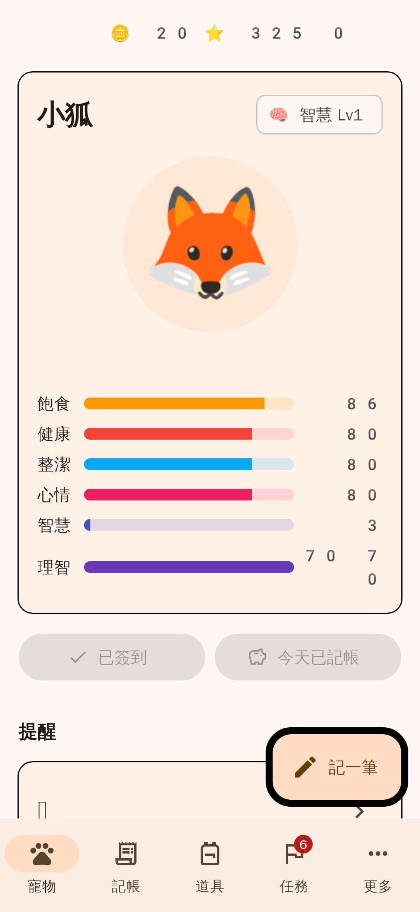
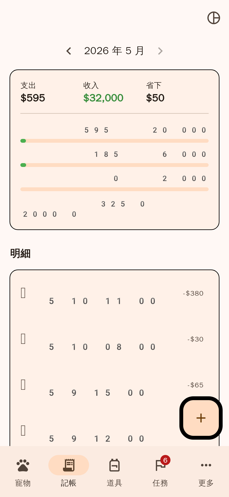
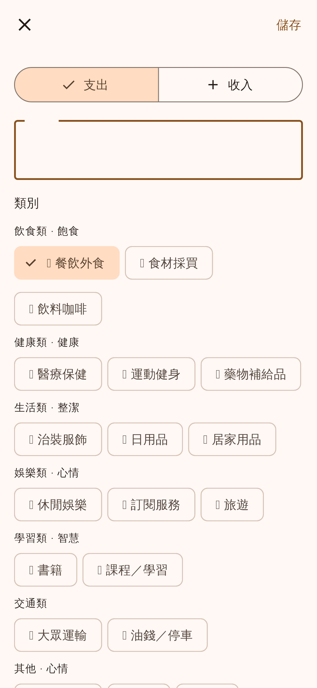
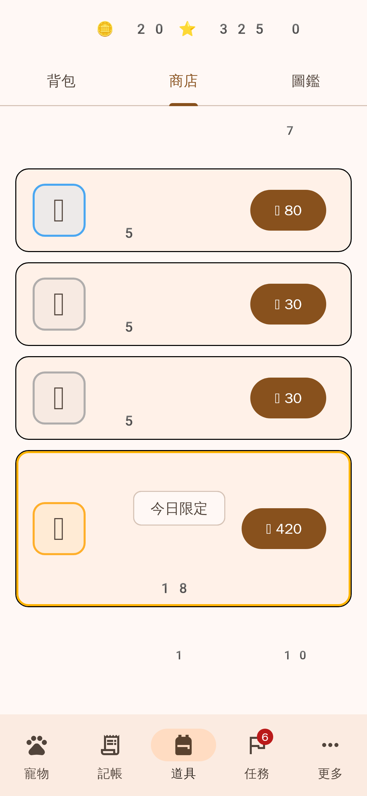
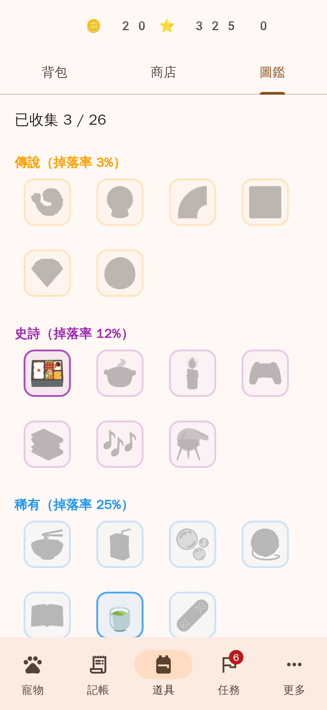
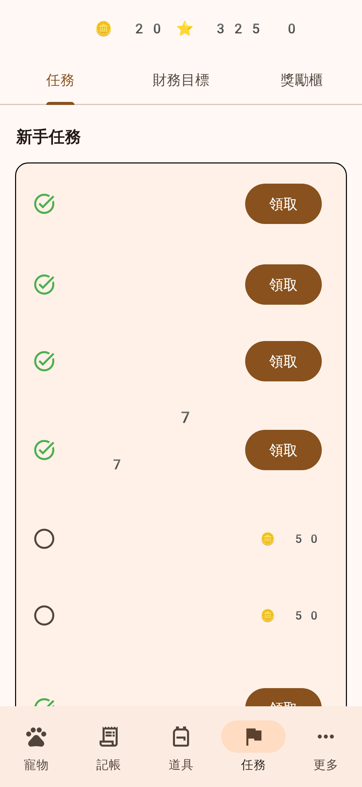
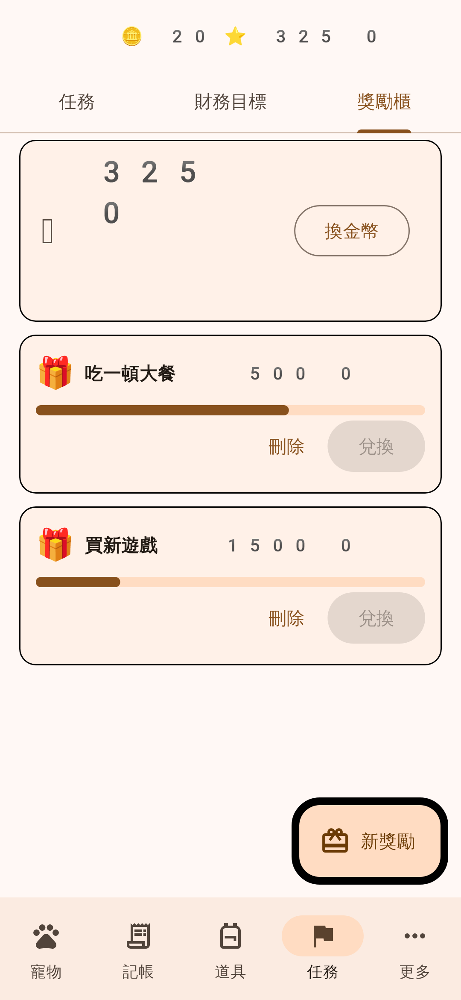
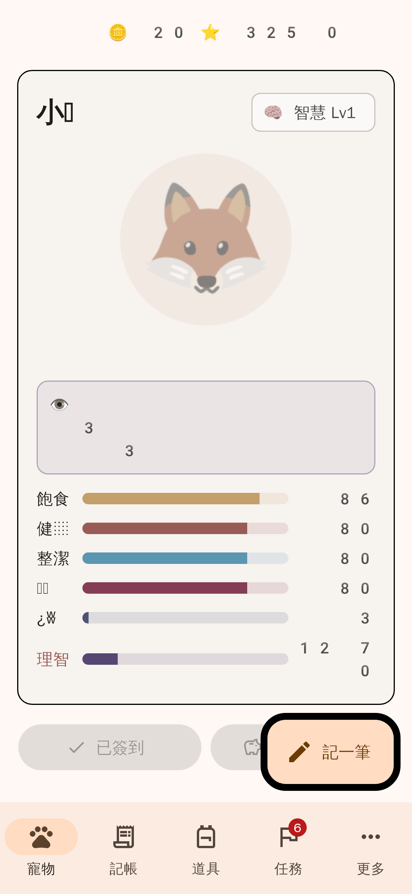
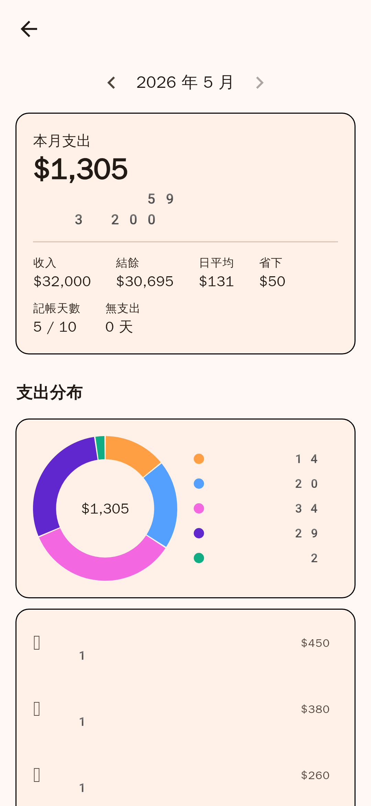
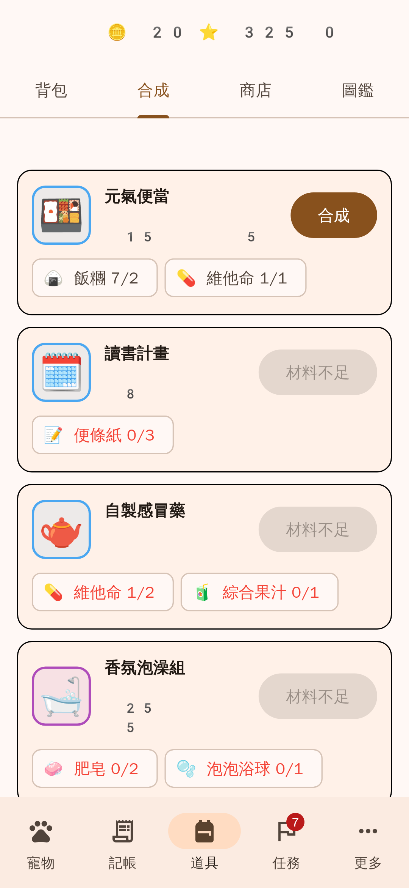

# 錢寵（Money Pet）

記帳養寵物，省錢換獎勵。Flutter APP，資料只存在手機本地（SQLCipher 加密）。

完整企劃見 [`docs/design.md`](docs/design.md)。

| 首頁 | 記帳 | 記一筆 | 商店 |
|---|---|---|---|
|  |  |  |  |
| **圖鑑** | **任務** | **獎勵櫃** | **San 值失控** |
|  |  |  |  |
| **月報表** | **合成** | | |
|  |  | | |

> 截圖是在測試環境用系統字型渲染的，部分 emoji 與數字間距和實機不同。

## 下載測試版 APK

每次 push 到 `main`，GitHub Actions 會自動跑測試並編譯 APK：
**Actions → 最新一次 CI → Artifacts → `money-pet-apk`**，解壓縮後傳到手機安裝。
（目前用 debug key 簽章，只適合測試，不能上架。）

## 開發

```bash
flutter pub get
flutter run            # 需接 Android 手機或模擬器
flutter test           # 單元 + 整合 + widget 測試
flutter analyze
```

重新產生截圖（需要 Linux 的文泉驛正黑與 Noto Color Emoji 字型）：

```bash
SCREENSHOTS=1 flutter test --update-goldens test/screenshots/
```

## 架構

```
lib/
  domain/     純 Dart 規則（無 I/O，全部有單元測試）
    pt_rules.dart       PT 計算、每月上限、月結算
    pet_rules.dart      屬性下降、San 值、生病、道具效果、San check
    items.dart          道具清單、稀有度掉落
    shop_rules.dart     每日商店（以日期為種子）
    finance_rules.dart  帳單到期日、信用卡週期與警戒
    tasks.dart          任務定義
  data/       SQLite schema、資料模型、設定、SQLCipher 開啟
  services/   業務流程（每個寫入都包在 transaction 裡）
  state/      Riverpod providers
  ui/         畫面
test/
  domain/     規則單元測試
  services/   整合測試（sqflite_common_ffi in-memory）
  widget/     完整操作流程測試
```

**資料慣例**
- 金幣與 PT 餘額**由 log 加總而來**（`coin_log`、`pt_log`），log 是唯一真相來源，不另存餘額。
- PT 一律存 **deci-PT 整數**（1 = 0.1 PT），避免浮點誤差；1 deci-PT = 1 金幣。
- 改 schema：`schemaVersion + 1`，並在 `database.dart` 的 `_migrations` 加步驟。

## 已實作

**記帳**
- 支出 / 收入、19 個子類別、支付工具、本次省下金額、補記過去日期、編輯、刪除
- 本日無支出打卡
- 預算（總額 + 七大類），新月份自動沿用上月
- 月報表：類別圓環圖、近 6 個月趨勢、最大一筆、支付工具（信用卡檢討）

**寵物**
- 六種屬性、每日自然下降（離線多天會補算）、戳戳隨機反應、智慧等級
- San 值：四種 San check、失控（亂碼 + 去飽和 + 動作凍結 + 商店 / 合成暫停）、連續記帳 3 天恢復
- 生病：單一類別超支 → 對應病症，5 天自動康復或用藥
- 寵物日記（智慧 Lv3 解鎖閱讀）
- 進化（智慧 Lv5 + 養 30 天）

**道具**
- 26 種食材 + 8 種合成成品、四級稀有度掉落、背包、使用、賣出、圖鑑
- 合成：8 個配方，全家福大餐需智慧 Lv4
- 商店：每日 4 格（含 7 折限定），每格每天限購一次

**PT 與獎勵**
- 收入、省下金額、月底兩層結算（雙重獎勵、半數超支無 PT、預算暴擊雙倍）
- 每月 PT 上限、PT 換金幣、獎勵櫃、財務目標

**任務**：新手、每日（簽到 / 戳戳 / 記帳）、固定（每 3 天更新資產）、里程碑（連續 7 / 30 天、100 筆、第一次兌換）

**財務工具**
- 資產統計（銀行 / 證券含股票 / 現金）與 90 天趨勢
- 帳單提醒（每月 / 季 / 年、逾期顯示、一鍵記帳）、信用卡本期額度警戒

**商業模式**
- 激勵廣告：看廣告領金幣（每天 5 次）、看廣告重抽道具（每天 2 次），完全自願
- 付費進階版（NT$90 買斷）：免看廣告、無限重抽、每日簽到加碼道具、恢復購買

**其他**
- 分享圖片（寵物卡，不含支出金額）
- 本地推播：帳單、每日記帳、資產更新（inexact 排程，不需精確鬧鐘權限）
- 備份 / 還原（JSON）＋記帳明細 CSV，透過系統分享選單匯出
- Onboarding（中途離開會從未完成的步驟繼續）、設定頁、清除所有資料
- SQLCipher 加密，金鑰存在 Android Keystore / iOS Keychain
- 隱私權政策（[`docs/privacy.md`](docs/privacy.md)）

## 設計決策（企劃書以外補充的規則）

| 項目 | 決定 |
|---|---|
| 省下金額 | 不能超過消費金額（UI 與資料庫 CHECK 都會擋） |
| 每月 PT 上限 | 預設 2000 PT，可在設定調整，0 = 不限。涵蓋收入、省下金額、月結算；**財務目標不受限** |
| 沒設預算 | 只拿道具，不拿任何自動 PT（財務目標仍可拿） |
| 補記過去月份 | 只拿道具，不拿 PT（避免補記舊帳刷 PT） |
| 刪除交易 | 退回該筆 PT（上限額度也回補）；道具若還在背包就收回 |
| 每日掉落上限 | 預設 10 次，用計數器而非筆數，「新增 → 用道具 → 刪除」也刷不到 |
| 記帳屬性加成 | 每筆支出對應屬性 +3，與金額無關（不鼓勵消費），和掉落共用每日上限 |
| 打卡後又記支出 | 自動取消當天的本日無支出，並收回打卡金幣 |
| 超支生病 | 記帳當下即判定；同類別同月份只觸發一次 |
| 月結算時機 | 新月份第一次開 APP 時結算上個月 |
| San check | 多個觸發條件只擲一次；失敗率 50%，每智慧等級 -5% |
| San 上限 | 初始值 + (智慧等級 − 1) × 5，最高 100（「智慧轉換 San」的暫定版） |
| 失控 | 屬性每天額外 -2；連續記帳 3 天、或理智道具讓 San 回到 40 以上即恢復 |
| 深夜記帳 | 凌晨 0:00–4:59 |
| 預算暴擊 | 總額省下 ≥ 20% 且沒有類別超支 → 月結算 PT ×2（仍受上限） |
| 編輯交易 | PT 重算（舊的退回、新的再發），不重新掉道具、不觸發 San check |
| 合成成品 | 只能合成取得，不會掉落、商店不賣；可同時加多種屬性 |
| 日記 | 每天都寫，智慧 Lv3 才能看（解鎖後可以看到以前的） |
| 進化 | 智慧 Lv5 + 養滿 30 天 + 沒有失控；理智上限 +10 |
| 寵物外觀 | MVP 先用 emoji，之後換 itch.io 像素素材 |

## 還沒做（下一步）

- FCM 全體推播
- Google Drive 自動備份（目前可手動匯出到 Drive）
- 換成正式的 AdMob ID、建立正式簽章金鑰、在 Play Console 建立 `premium_unlock` 商品（見 [`docs/release-checklist.md`](docs/release-checklist.md)）
- 正式美術（目前 icon 與寵物用 emoji，icon 來自 Noto Emoji，Apache 2.0）
- 把隱私權政策用 GitHub Pages 公開，並填入聯絡信箱
- v2.0：多隻寵物、拼接款 / 惡搞款寵物、信用卡優惠情報
